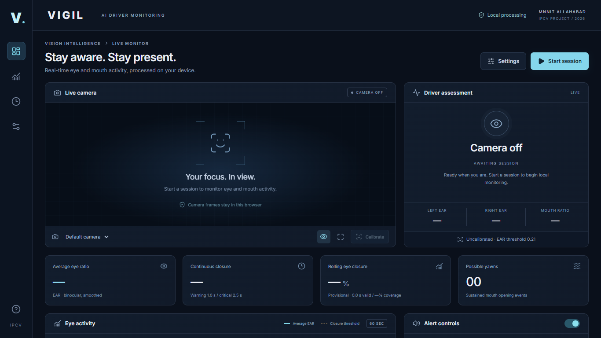

# VIGIL — AI Driver Monitoring

A local browser application for the MNNIT Allahabad Image Processing and Computer Vision demonstration. Submission target: **31 October 2026**. React + Vite + JavaScript, MediaPipe Face Landmarker, Lucide icons, Web Audio, and a pure deterministic fatigue analyzer.

**Experimental educational prototype. Not medically validated or suitable as a real driving safety system.** No accuracy percentage or real-world validation is claimed.



## Fresh checkout

In Ubuntu WSL, with Git and nvm installed:

```bash
git clone https://github.com/SahilPtl/CV-based-Drowsiness-Detection-System.git
cd CV-based-Drowsiness-Detection-System
source ~/.nvm/nvm.sh
nvm install
nvm use
npm ci
npm run setup:assets
npm run dev
```

Open **http://localhost:5173/** in Windows Chrome or Edge. Dependencies, generated workers, and downloaded model/WASM files are excluded from Git; `npm run setup:assets` prepares the required local assets. The repository includes source, locked dependency versions, tests, documentation, and automated-test evidence. For this existing laptop workspace, use the instructions below.

## Start in Ubuntu WSL

The project is already in the selected workspace; there is no nested application folder:

```text
C:\Users\sahil\OneDrive\Documents\ChatGPT\IPCV drowsiness detection system
```

Open Ubuntu and run:

```bash
cd '/mnt/c/Users/sahil/OneDrive/Documents/ChatGPT/IPCV drowsiness detection system'
source ~/.nvm/nvm.sh
nvm use
npm ci
npm run setup:assets
npm run dev
```

Open **http://localhost:5173/** in Windows Chrome or Edge. Allow the webcam, click **Start session**, then **Test Alarm**. Calibrate with eyes naturally open. Keep only one person in view. A local server must remain running. Ctrl+C stops it. See [SETUP_WSL.md](SETUP_WSL.md) for first-time installation and troubleshooting.

After dependencies and assets are installed, startup does not require external network access. Do not delete `public/assets/` before an offline demonstration. Camera frames and measurements stay in browser memory; nothing is uploaded. Only validated nonsensitive settings are stored in localStorage. Calibration is session-scoped. Export is an explicit local JSON download without images or raw landmarks.

## What it implements

- Actual pretrained face landmarks, subject-left/right EAR, average EAR, and normalized mouth opening.
- Elapsed-time eye-closure warning and critical alert, opening recovery, validity gaps and reacquisition.
- Time-weighted rolling closure, coverage/readiness gating, separate rolling-warning hysteresis.
- Possible-yawn episodes, close-to-rearm logic, guided robust per-eye calibration.
- Local model/WASM assets, classic worker, one frame in flight, GPU with CPU fallback.
- Start/Stop, device selection, overlays, settings/reset, sound/volume, test sound, 10-second silence.
- Live EAR history with gaps, event timeline, session denominators, counts, and JSON export.
- Hidden-tab pause, camera cleanup, generation guards, and actionable errors.

There is no simulation mode, backend, account, paid API, custom model training, or training dataset. **ML estimates landmarks; this project computes geometry and applies explicit heuristic rules.** See [ALGORITHM.md](ALGORITHM.md).

## Architecture

```text
src/
  analysis/     config, geometry, rolling intervals, calibration, analyzer
  vision/       local MediaPipe loader, worker and bounded client
  browser/      session/camera controller and Web Audio manager
  hooks/        React lifecycle connection and preferences
  components/   camera/overlay, EAR chart, settings and calibration
  App.jsx       dashboard, session summary, timeline, export UI
  styles.css    responsive local-font interface
scripts/        asset setup/integrity verification and isolated browser QA
public/assets/  model, four WASM loader/binary files, worker, integrity manifest
tests/          deterministic analysis and mocked browser/audio integration
evidence/       actual automated-browser screenshots and result JSON
```

The controller owns the session; React renders analyzer results. Synthetic observations exist only in tests. The separate browser QA script injects blank test video solely into its isolated test context; it does not prove fatigue detection.

## Tested environment and versions

- Ubuntu 22.04 WSL, Linux Node **22.12.0**, npm **11.1.0**, working directly in the Windows workspace through `/mnt/c`.
- Windows system Node 20.16.0 was inspected but **not used** for install/build. Linux `node_modules` only.
- React/react-dom 19.3.1, Vite 8.3.5, plugin-react 6.1.2, MediaPipe tasks-vision 0.10.32, Lucide React 1.61.0.
- Vitest 5.0.5, ESLint 9.39.1. All direct dependencies are exact-pinned; `package-lock.json` is included. ESLint 9 produced a maintenance/deprecation notice at install; it is compatible with the existing Linux Node and lint passed. No unrelated system upgrades were performed.
- Browser automation uses installed Windows Edge and the bundled Playwright runtime. See [TESTING.md](TESTING.md) for the exact browser version and commands actually executed.

The selected toolchain uses Node 22.12+; current Vite also documents Node 20.19+ / 22.12+ requirements. The project excludes Node 20 because its chosen Vitest requires 22.12+. [Vite guide](https://vite.dev/guide/).

MediaPipe is intentionally pinned to 0.10.32. The newer 1.1.1 package was inspected and rejected because it contains usage-metrics reporting. The chosen package was checked for that sender; production checks reject known telemetry signatures. A same-origin Content Security Policy is also served by Vite. Its classic WASM loader requires a classic worker, so setup/build bundles the worker as an IIFE; it uses the same generated file in development and production. After editing worker source, rerun `npm run setup:assets` or `npm run build` and reload.

## Commands

| Command | Purpose |
| --- | --- |
| `npm ci` | Reproduce locked Linux dependencies |
| `npm run setup:assets` | Validate/download pinned official model and copy matching WASM variants |
| `npm run dev` | WSL server, port 5173, strict port |
| `npm run lint` | ESLint, including hook rules |
| `npm test -- --run` | Deterministic and browser-API mock tests |
| `npm run build` | Production bundle and asset/worker integrity check |
| `npm run preview` | Serve production output at http://localhost:4173/ |

Read [TESTING.md](TESTING.md) for evidence and remaining physical-laptop checks, [DEMO_GUIDE.md](DEMO_GUIDE.md) for the four-student presentation, and [ASSETS.md](ASSETS.md) for provenance/checksums. No university report or slide deck is included.
